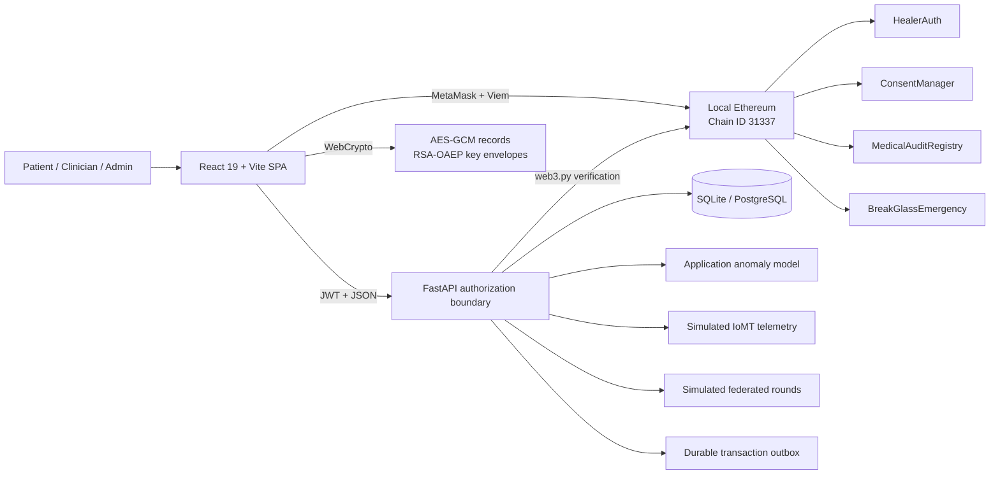

<p align="center">
  
</p>

<h1 align="center">HealerPlus</h1>

<p align="center">
  <strong>Enhancing Healthcare Security Through Blockchain, AI and Privacy-Preserving Record Exchange</strong>
</p>

<p align="center">
  A full-stack academic platform combining a premium healthcare portal, encrypted medical records,
  role-aware access control, Ethereum consent, anomaly detection and simulated IoMT monitoring.
</p>

<p align="center">
  
  
  
  
  
  
  
</p>

<p align="center">
  <a href="#-quick-start">Quick start</a> •
  <a href="#-system-architecture">Architecture</a> •
  <a href="#-security-model">Security</a> •
  <a href="#-smart-contracts">Smart contracts</a> •
  <a href="#-testing-and-verification">Testing</a> •
  <a href="#-documentation">Documentation</a>
</p>

> [!IMPORTANT]
> HealerPlus is an academic technology demonstration. It is not a regulated clinical system, diagnostic tool, emergency service, or production-ready patient-record platform. Never enter real patient information, production wallet credentials, or recovery phrases.

## ✨ Project overview

HealerPlus explores how modern web engineering, client-side cryptography, blockchain verification and machine-learning-assisted monitoring can work together at a healthcare security boundary. The application deliberately distinguishes between capabilities that are implemented, demonstrations that are simulated, and integrations that require external infrastructure.

<table>
  <tr>
    <td width="50%">
      
    </td>
    <td width="50%">
      
    </td>
  </tr>
  <tr>
    <td align="center"><strong>Patient-centred digital care</strong></td>
    <td align="center"><strong>Secure connected facilities</strong></td>
  </tr>
</table>

### What the project demonstrates

| Area | Implementation |
|---|---|
| Healthcare experience | Responsive React portal with services, professionals, facilities, contact, authentication, appointments and protected dashboards |
| Identity and authorization | Patient-only public registration, revocable sessions, current database role checks, staff creation and administrator approval |
| Encrypted records | AES-256-GCM record encryption in the browser and recipient-specific RSA-3072 OAEP/SHA-256 key envelopes |
| Consent and auditability | MetaMask-signed local-chain consent, transaction receipt validation, contract-state checks and durable consent projections |
| Blockchain security | Four Solidity contracts for identity, consent, audit registration and emergency break-glass access |
| AI-assisted security | Reproducible local anomaly-detection pipeline with explicit toy-dataset limitations |
| Connected health | Simulated IoMT telemetry inspection and a labelled in-process federated-learning demonstration |
| Persistence | SQLAlchemy with SQLite for local development, PostgreSQL 16 through Docker and Alembic migrations |

## 🧭 System architecture



The application is a modular monolith: one React SPA communicates with one FastAPI service. SQLAlchemy stores identities, sessions, login attempts, appointments, encrypted envelopes, audit events, telemetry events, chain intents and outbox jobs. Blockchain transactions remain untrusted until the backend verifies the network, receipt, sender, destination, function arguments, event and current contract state.

## 🛡️ Capability status

| Capability | Status | Notes |
|---|---:|---|
| Accounts, roles and revocable sessions | ✅ Implemented | Persisted with SQLAlchemy; authorization is rechecked on protected requests |
| Appointment requests | ✅ Implemented | Requests persist but do not represent confirmed clinical availability |
| Client-encrypted record storage | ✅ Implemented | The server stores ciphertext and wrapped keys, not plaintext records |
| Local blockchain contracts | ✅ Implemented | Hardhat network only; deployment is restricted to chain ID `31337` |
| Wallet consent verification | ⚙️ Configuration dependent | Requires the local node, deployed contracts and MetaMask |
| AI intrusion detection | 🧪 Development model | Trained from the checked-in 40-row demonstration dataset |
| IoMT monitoring | 🧪 Simulated | No physical medical device is connected |
| Federated learning | 🧪 Simulated | In-process FedAvg demonstration; no real hospitals or privacy guarantee |
| Ciphertext storage | ✅ Local / optional remote | Database-backed locally; Kubo or Pinata can be configured explicitly |
| Emergency key delivery | ⚙️ Configuration dependent | Requires institutional RSA escrow and a verified break-glass transaction |

## 🧰 Technology stack

| Layer | Technologies |
|---|---|
| Frontend | React 19, TypeScript 5.9, Vite 7, React Router, Framer Motion, Lucide, Embla Carousel, Viem |
| Backend | Python 3.11, FastAPI, Uvicorn, Pydantic, SQLAlchemy, Alembic, PyJWT |
| Cryptography | Web Crypto API, AES-256-GCM, RSA-3072 OAEP/SHA-256, PBKDF2-SHA-256 |
| AI and data | scikit-learn, pandas, NumPy, joblib, Random Forest, histogram gradient boosting, Isolation Forest |
| Blockchain | Solidity 0.8.20, Hardhat, Ethers.js, web3.py, MetaMask |
| Storage | SQLite, PostgreSQL 16, optional Kubo/Pinata ciphertext providers |
| Operations | Docker Compose, Windows launchers, Pytest |

## 🚀 Quick start

### Prerequisites

- Python `3.11`
- Node.js `20`, `22`, or `24`
- Git
- MetaMask only for local blockchain transactions
- Docker Desktop only for the PostgreSQL deployment

### 1. Clone the repository

```powershell
git clone https://github.com/EmanFatima045/Enhancing-Healthcare-through-Blockchain-And-AI-anomly-detectiom.git
cd Enhancing-Healthcare-through-Blockchain-And-AI-anomly-detectiom
```

### 2. Configure the environment

```powershell
Copy-Item .env.example .env
```

Open `.env` and replace `HEALER_SECRET_KEY` with a unique random value containing at least 32 characters. The backend intentionally refuses to start without it. The real `.env` file is excluded from Git.

### 3. Install dependencies

```powershell
python -m pip install -r backend/requirements.txt

cd frontend
npm install
cd ..

cd blockchain
npm install
cd ..
```

### 4. Initialize the database

```powershell
cd backend
python -m alembic -c alembic.ini upgrade head
cd ..
```

Create the first trusted local administrator. The password prompt is hidden and requires at least 10 characters.

```powershell
python backend/manage.py create-admin --email admin@example.test --name "Local Administrator"
```

### 5. Start the application

On Windows, the simplest option is:

```powershell
.\run_all.bat
```

Or start each service manually in separate terminals:

```powershell
# Terminal 1 — API
python backend/run_backend.py

# Terminal 2 — outbox worker (blockchain attestations and notifications)
python -m backend.worker

# Terminal 3 — web application
cd frontend
npm run dev
```

| Service | Local URL |
|---|---|
| Web application | <http://127.0.0.1:3000> |
| FastAPI root | <http://127.0.0.1:8000> |
| Interactive API documentation | <http://127.0.0.1:8000/docs> |
| Health check | <http://127.0.0.1:8000/api/v1/health> |
| Readiness check | <http://127.0.0.1:8000/api/v1/health/ready> |

## 🐳 Docker API and PostgreSQL

The Compose stack starts PostgreSQL 16, the backend API, the durable outbox worker, and the production Nginx-served frontend at `http://localhost`.

```powershell
$env:POSTGRES_PASSWORD = "choose-a-strong-password"
$env:HEALER_SECRET_KEY = "choose-at-least-32-random-characters"
docker compose up --build
```

Run Alembic migrations before upgrading an existing deployment.

## 🔐 Security model

### Authentication and roles

- Public signup creates only a verified `Patient` account.
- A `HospitalAdmin` creates staff and explicitly approves them.
- JWTs contain the subject and session identifier; current role, verification, activity, expiry and revocation are checked from persistent state.
- Logout revokes the server-side session.
- The SPA keeps its short-lived bearer token in `sessionStorage`. Production should use secure HTTP-only cookies with CSRF protection and a strict Content Security Policy.

### Encrypted record lifecycle

1. The browser creates a new AES-256-GCM data key and 12-byte nonce for every record version.
2. Plaintext is encrypted before upload, with canonical record metadata authenticated as additional data.
3. The AES key is wrapped separately for each recipient with RSA-3072 OAEP/SHA-256.
4. The non-extractable working private key stays in browser IndexedDB.
5. Recovery uses an encrypted PKCS#8 backup protected by PBKDF2-SHA-256 and AES-GCM.
6. Sharing unwraps and rewraps the data key locally; private keys and plaintext are never sent to the API.
7. Revocation blocks future API delivery but cannot erase information already downloaded by a recipient.

Losing both the browser key and encrypted backup makes old records cryptographically unrecoverable. An Ethereum wallet is not a record-decryption key.

## ⛓️ Smart contracts

| Contract | Responsibility |
|---|---|
| `HealerAuth.sol` | Patient registration, trusted staff assignment, verification and account status |
| `ConsentManager.sol` | Patient-owned, category-aware read/write consent with expiry and revocation |
| `MedicalAuditRegistry.sol` | Opaque record commitments, restricted audit entries and incident attestations |
| `BreakGlassEmergency.sol` | Time-bounded emergency sessions tied to a doctor, patient and record |

Contracts store opaque identifiers and commitments—never names, diagnoses, record plaintext, encryption keys or detailed emergency justification.

### Run the local blockchain

```powershell
cd blockchain
npm test
npm run node
```

Keep the node running, then deploy from a second terminal:

```powershell
cd blockchain
npm run deploy:local
```

The deployment exports addresses and ABIs to the blockchain, backend and frontend trees. The local node uses <http://127.0.0.1:8545> and chain ID `31337`. Use only the throwaway accounts printed by Hardhat.

## 🤖 AI, IoMT and federated demonstrations

The detector loads versioned artifacts instead of training during API startup. Reproduce its experiment with:

```powershell
python -m backend.app.ml.experiments all
```

The report records class support, macro F1, precision/recall, confusion matrix, attack PR-AUC, false-positive rate, latency, versions, schemas, thresholds, seeds and checksums. Results from the 40-row synthetic fixture are toy results and must not be presented as real-world accuracy evidence.

IoMT values and federated rounds are explicitly simulated. The system makes no claim of clinical validation, real-device connectivity, secure aggregation or differential privacy.

## 🔌 API surface

All application routes are prefixed with `/api/v1`.

| Route group | Purpose |
|---|---|
| `/auth` | Registration, login/logout, profile updates, password recovery, staff approval, encryption keys and recipients |
| `/appointments` | Create, list and cancel appointment requests |
| `/records` | Encrypted versions, recipient key envelopes, consent and break-glass requests |
| `/blockchain` | Wallet challenges, consent intents, receipt submission and emergency state |
| `/audit` | Role-scoped access and workflow history |
| `/notifications` | Authenticated local notification inbox |
| `/operations` | Restricted outbox health and recent job metadata for administrators |
| `/security` | Event evaluation, restricted attack simulation, threat feed and model metrics |
| `/iomt` | Simulated telemetry stream and inspection |
| `/federated` | Simulation status and restricted training rounds |

Browse the live schema at <http://127.0.0.1:8000/docs> after starting the backend.

## ✅ Testing and verification

Every push and pull request runs the frontend production build, Solidity security tests, and backend acceptance tests through [GitHub Actions](.github/workflows/ci.yml).

```powershell
# Backend acceptance flow
python -m pip install -r backend/requirements-dev.txt
python -m pytest backend/tests -q

# Frontend type-check and production bundle
cd frontend
npm run build

# Solidity security tests
cd ../blockchain
npm test
```

Verified on 18 October 2026:

| Check | Result |
|---|---:|
| Backend acceptance tests | ✅ 3 passed |
| Solidity authorization/security tests | ✅ 7 passed |
| React production build | ✅ Completed |

The frontend build uses deterministic vendor code splitting; the remaining performance opportunity is optimizing the large photographic PNG assets.

## 📁 Repository structure

```text
.
├── frontend/                 # React/Vite application and healthcare imagery
│   ├── src/                  # Routes, record vault, WebCrypto and wallet client
│   └── assets/               # Local interface photography
├── backend/                  # FastAPI service, persistence and security boundary
│   ├── app/api/              # Authentication, records, blockchain, IDS and IoMT APIs
│   ├── app/core/             # Configuration, auth, crypto and database controls
│   ├── app/ml/               # Detection experiments and model artifacts
│   ├── alembic/              # Database migrations
│   └── tests/                # Acceptance tests
├── blockchain/               # Solidity contracts, deployment and security tests
├── datasets/                 # Small demonstration datasets
├── docs/                     # Architecture, security and experiment documentation
├── docker-compose.yml        # PostgreSQL + API + worker + Nginx stack
└── run_all.bat               # Windows development launcher
```

## 📚 Documentation

- [Architecture](docs/ARCHITECTURE.md)
- [Cyber-security analysis](docs/CYBER_SECURITY_ANALYSIS.md)
- [Smart-contract security specification](docs/SMART_CONTRACT_SPEC.md)
- [MetaMask and local-chain setup](docs/METAMASK_AND_LIVE_SETUP.md)
- [Machine-learning experiments](docs/ML_EXPERIMENTS.md)
- [Implementation report](docs/PROJECT_REPORT.md)
- [Operations runbook](docs/OPERATIONS.md)

## 🗺️ Limitations and roadmap

- Replace browser-readable bearer tokens with hardened cookie sessions.
- Add CSP, CSRF controls, managed secrets, encrypted backups and operational monitoring.
- Split the frontend bundle and optimize the large PNG assets.
- Integrate approved encrypted object storage or a reviewed IPFS pinning workflow.
- Validate against representative, independently governed datasets.
- Connect real IoMT ingestion only after device identity, transport security and clinical-safety review.
- Evaluate contracts through an independent smart-contract security audit.
- Add real federated participants, secure aggregation and a measured privacy mechanism.
- Complete jurisdiction-specific privacy, retention and regulatory review before real-world use.

## 🤝 Contributing

Contributions are welcome for academic and defensive-security improvements. Keep capability labels honest, add tests for security-sensitive changes, and never commit secrets, real patient data, private keys or production wallet material.

1. Fork the repository.
2. Create a focused feature branch.
3. Run the backend, frontend and contract checks.
4. Open a pull request explaining the security and data-handling impact.

---

<p align="center">
  Built as an academic exploration of safer, more transparent digital healthcare systems.
</p>
