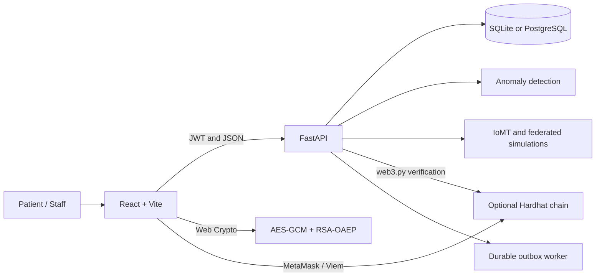

<p align="center">
  
</p>

<h1 align="center">HealerPlus</h1>

<p align="center">
  <strong>A healthcare security demonstration built with React, FastAPI, AI-assisted monitoring, and Ethereum smart contracts.</strong>
</p>

<p align="center">
  
  
  
  
  
</p>

> [!IMPORTANT]
> HealerPlus is an academic demonstration. It is not a regulated clinical system, diagnostic tool, emergency service, or production patient-record platform. Do not enter real patient information, production credentials, private keys, or wallet recovery phrases.

## About the project

HealerPlus explores how a modern healthcare portal can combine role-aware access control, browser-side record encryption, blockchain-backed consent, anomaly detection, and simulated connected-device monitoring.

The project contains:

- A responsive React and TypeScript patient portal
- A FastAPI backend with persistent accounts, sessions, appointments, records, audit events, and notifications
- Client-side AES-GCM record encryption and RSA-OAEP key wrapping
- Solidity contracts for identity, consent, audit commitments, and emergency access
- A local anomaly-detection pipeline for security events
- Explicitly simulated IoMT telemetry and federated-learning demonstrations
- SQLite for local development and PostgreSQL through Docker Compose
- Responsive WebP imagery for mobile and desktop displays

## Main features

| Area | Current implementation |
|---|---|
| Public website | Home, about, services, professionals, facilities, contact, FAQ, privacy, terms, and security pages |
| Authentication | Patient registration, login, logout, password recovery, revocable sessions, and role checks |
| Appointments | Patient requests, personal appointment history, cancellation requests, and staff review |
| Medical records | Browser-encrypted record versions and recipient-specific wrapped keys |
| Access history | Role-scoped audit events without medical plaintext or encryption keys |
| Notifications | Local authenticated notification inbox with optional SMTP delivery |
| Security monitoring | Local development IDS model, incident feed, and restricted staff console |
| Blockchain | Optional local Hardhat network and four Solidity contracts on chain ID `31337` |
| IoMT and federated learning | Labelled simulations; no physical devices or real hospital participants |

## Architecture



The frontend uses `/api` through Vite's development proxy. The backend treats blockchain operations as configuration-dependent and continues to provide its non-blockchain features when no RPC endpoint is configured.

## Technology stack

| Layer | Technologies |
|---|---|
| Frontend | React 19, TypeScript 5.9, Vite 7, React Router, Framer Motion, Lucide, Embla Carousel, Viem |
| Backend | Python, FastAPI, Uvicorn, Pydantic, SQLAlchemy, Alembic, PyJWT |
| Data and AI | scikit-learn, pandas, NumPy, joblib |
| Blockchain | Solidity 0.8.20, Hardhat, Ethers.js, web3.py, MetaMask |
| Storage | SQLite, PostgreSQL 16, optional Kubo or Pinata ciphertext storage |
| Operations | Docker Compose, Windows launchers, Pytest, GitHub Actions |

## Quick start on Windows

### Prerequisites

- Python 3.11 or a compatible Python 3 installation
- Node.js 20 or newer with npm
- Git
- Docker Desktop only if using the containerized PostgreSQL stack
- MetaMask only if testing wallet and blockchain workflows

### 1. Clone the repository

```powershell
git clone https://github.com/EmanFatima045/Enhancing-Healthcare-through-Blockchain-And-AI-anomly-detectiom.git
cd Enhancing-Healthcare-through-Blockchain-And-AI-anomly-detectiom
```

### 2. Create the local environment file

```powershell
Copy-Item .env.example .env
```

Open `.env` and replace the value of `HEALER_SECRET_KEY` with a unique random string of at least 32 characters. Keep `.env` private; it is excluded from Git.

The Windows backend launcher can also create `.env` automatically with a generated local secret when the file is missing.

### 3. Install dependencies

```powershell
python -m pip install -r backend/requirements.txt

Push-Location frontend
npm install
Pop-Location

Push-Location blockchain
npm install
Pop-Location
```

### 4. Start the application

```powershell
.\run_all.bat
```

The launcher opens separate windows for:

- FastAPI backend on <http://127.0.0.1:8000>
- Durable outbox worker
- Vite frontend on <http://127.0.0.1:3000>

It does not start the optional blockchain. See [Local blockchain](#local-blockchain) when testing contract-backed features.

### Start services manually

Use three PowerShell terminals from the repository root:

```powershell
# Terminal 1: backend
python backend/run_backend.py
```

```powershell
# Terminal 2: worker
python -m backend.worker
```

```powershell
# Terminal 3: frontend
Set-Location frontend
npm run dev
```

### Local URLs

| Service | URL |
|---|---|
| Website | <http://127.0.0.1:3000> |
| Backend status | <http://127.0.0.1:8000> |
| OpenAPI documentation | <http://127.0.0.1:8000/docs> |
| Health endpoint | <http://127.0.0.1:8000/api/v1/health> |
| Readiness endpoint | <http://127.0.0.1:8000/api/v1/health/ready> |
| Prometheus metrics | <http://127.0.0.1:8000/metrics> |

## Local blockchain

Blockchain support is optional. Start the Hardhat node in one terminal:

```powershell
Set-Location blockchain
npm run node
```

Deploy the contracts from a second terminal:

```powershell
Set-Location blockchain
npm run deploy:local
```

The deployment exports contract addresses and ABIs for the backend and frontend. The local RPC endpoint is `http://127.0.0.1:8545`, and its chain ID is `31337`.

To use MetaMask, add the local network and import only a throwaway Hardhat development account. Never use a real wallet recovery phrase. See [MetaMask and local-chain setup](docs/METAMASK_AND_LIVE_SETUP.md) for details.

## Docker Compose

The default Compose stack runs PostgreSQL, the API, the outbox worker, and the Nginx-served frontend.

```powershell
$env:POSTGRES_PASSWORD = "choose-a-strong-local-password"
$env:HEALER_SECRET_KEY = "choose-at-least-32-random-characters"
docker compose up --build
```

Open the containerized website at <http://127.0.0.1:32769>.

Optional local integrations are available through the `integrations` profile:

```powershell
docker compose --profile integrations up --build
```

This profile also starts Hardhat, Mailpit, Kubo, and Prometheus. Consult [Operations](docs/OPERATIONS.md) before changing storage or notification providers.

## Security model

- Public registration creates patient accounts only.
- Protected requests recheck the current session and database-backed role.
- Logout revokes the server-side session.
- Each record version is encrypted in the browser with a new AES-256-GCM key and nonce.
- Record keys are wrapped separately for authorized recipients with RSA-3072 OAEP/SHA-256.
- The backend stores ciphertext and key envelopes, not record plaintext.
- Blockchain receipts and contract state must be verified before they are trusted.
- API responses use restrictive security headers and disable caching for API routes.

This design is educational, not a security certification. Production use would require hardened cookie sessions, CSRF and CSP controls, managed secrets, monitoring, backups, independent testing, and legal and regulatory review.

## API groups

Application endpoints use the `/api/v1` prefix.

| Route group | Purpose |
|---|---|
| `/auth` | Accounts, sessions, profiles, password recovery, staff controls, and encryption keys |
| `/appointments` | Appointment requests and staff decisions |
| `/records` | Encrypted records, key envelopes, sharing, consent, and emergency workflows |
| `/blockchain` | Wallet challenges, transaction intents, receipts, and chain status |
| `/audit` | Authorized activity history |
| `/notifications` | User notification inbox |
| `/operations` | Restricted worker and outbox health |
| `/security` | Event evaluation, incident feed, and model metrics |
| `/iomt` | Simulated telemetry |
| `/federated` | Simulated federated-learning rounds |

The live, authoritative route schema is available at <http://127.0.0.1:8000/docs> while the backend is running.

## Testing

### Backend

```powershell
python -m pip install -r backend/requirements-dev.txt
python -m pytest backend/tests -q
```

### Frontend

```powershell
Set-Location frontend
npm run build
```

### Smart contracts

```powershell
Set-Location blockchain
npm test
```

GitHub Actions runs the repository's configured checks for pushes and pull requests. Test results should be taken from the current run rather than from hard-coded counts in this README.

## Image delivery

The interface uses optimized WebP assets with responsive mobile, tablet, and desktop candidates. React supplies `srcset`, `sizes`, intrinsic dimensions, eager loading for important above-the-fold images, and lazy loading for below-the-fold content. The conversion script and measured asset report are available at:

- [`scripts/optimize_images.py`](scripts/optimize_images.py)
- [`docs/image-optimization-report.json`](docs/image-optimization-report.json)

## Repository structure

```text
.
|-- frontend/              React, TypeScript, Vite, and responsive WebP assets
|-- backend/               FastAPI application, database, AI pipeline, and tests
|-- blockchain/            Solidity contracts, deployment scripts, and tests
|-- datasets/              Small academic demonstration datasets
|-- docs/                  Architecture, security, operations, and project reports
|-- monitoring/            Prometheus configuration
|-- scripts/               Local verification and image optimization utilities
|-- docker-compose.yml     PostgreSQL, API, worker, frontend, and integrations
`-- run_all.bat            Windows launcher for API, worker, and frontend
```

## Documentation

- [Architecture](docs/ARCHITECTURE.md)
- [Cybersecurity analysis](docs/CYBER_SECURITY_ANALYSIS.md)
- [Smart-contract specification](docs/SMART_CONTRACT_SPEC.md)
- [MetaMask and live setup](docs/METAMASK_AND_LIVE_SETUP.md)
- [Machine-learning experiments](docs/ML_EXPERIMENTS.md)
- [Project report](docs/PROJECT_REPORT.md)
- [Operations](docs/OPERATIONS.md)

## Known limitations

- AI results come from small demonstration data and are not evidence of production detection accuracy.
- IoMT telemetry and federated learning are simulations.
- Appointment requests do not represent real clinical availability.
- Contact details, professionals, facilities, and photography are illustrative.
- Blockchain features require a separately running chain, deployed contracts, and wallet configuration.
- Kubo, Pinata, SMTP, and emergency escrow require explicit external configuration.
- No real healthcare data should be stored in this academic environment.

## Contributing

Keep changes focused, add tests for security-sensitive behavior, and clearly label simulated or configuration-dependent capabilities. Never commit secrets, patient data, private keys, recovery phrases, or production credentials.

Before opening a pull request, run the backend tests, frontend build, and smart-contract tests relevant to your change.

---

<p align="center">Built as an academic exploration of safer and more transparent digital healthcare systems.</p>
